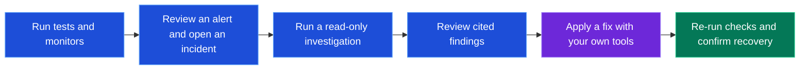

## Get started

<Cards>
<Card icon={<CalendarClock className="text-purple-500" />} title="Automate" href="/docs/app/automate">
Create a browser, API, database, agent or performance test
</Card>

<Card icon={<Terminal className="text-amber-500" />} title="CLI" href="/docs/cli">
CI/CD and monitoring-as-code
</Card>

<Card icon={<MousePointerClick className="text-sky-500" />} title="Recorder" href="/docs/recorder">
Record browser interactions as Playwright code
</Card>
</Cards>

## Quickstart

<Steps>
<Step>

### Open a workspace

[Self-host](/docs/app/deployment/self-hosted) with Docker Compose, or use Supercheck Cloud. On Cloud, create your account with GitHub, Google or an invitation link and verify your email. Then choose a plan on the subscribe page; eligible new accounts can start a free trial with no card. See [Pricing](/pricing).

</Step>
<Step>

### Create a test

Write one in the [Playground](/docs/app/automate/playground), or record it with the [Recorder](/docs/recorder).

</Step>
<Step>

### Run it on a schedule

Add the test to a [job](/docs/app/automate/jobs) with a cron schedule. To keep checking production, attach a Playwright test to a [synthetic monitor](/docs/app/monitor#synthetic-monitor). Add HTTP, website, ping, port or MCP monitors for uptime.

</Step>
<Step>

### Get alerted

Add a [notification channel](/docs/app/communicate/alerts) and select it on your monitors and jobs.

</Step>
<Step>

### Tell your users

Publish a [status page](/docs/app/communicate/status-pages) and link monitors to its components.

</Step>
</Steps>

To manage this as code, start with the [CLI](/docs/cli).

## By role

<Cards>
<Card icon={<Code className="text-sky-500" />} title="Developers" href="/solutions/developers">
Tests and monitors in your repository
</Card>

<Card icon={<Layers className="text-rose-500" />} title="SRE and platform" href="/solutions/sre">
Uptime, alerts, status pages, incident evidence
</Card>

<Card icon={<ClipboardCheck className="text-purple-500" />} title="QA engineers" href="/solutions/qa">
Playwright and k6 suites
</Card>

<Card icon={<Users className="text-amber-500" />} title="Engineering leaders" href="/solutions/engineering-leaders">
Requirement coverage, roles, audit log
</Card>
</Cards>

## Reliability workflow

Scroll horizontally on smaller screens to view all steps.

AI SRE suggests checks and fixes. You apply changes and confirm recovery.

## Core capabilities

<Cards>
<Card icon={<CalendarClock className="text-purple-500" />} title="Automate" href="/docs/app/automate">
Write, review and schedule tests.
</Card>

<Card icon={<Globe className="text-sky-500" />} title="Monitor" href="/docs/app/monitor">
Uptime checks and alerts.
</Card>

<Card icon={<Radio className="text-rose-500" />} title="Communicate" href="/docs/app/communicate">
Alert channels and status updates.
</Card>

<Card icon={<Search className="text-indigo-500" />} title="Respond" href="/docs/app/investigate">
Read-only investigations with cited evidence.
</Card>

<Card icon={<UserCog className="text-amber-500" />} title="Settings" href="/docs/app/admin">
Projects, members, permissions, integrations.
</Card>
</Cards>

## Your account

Open **Account** from the user menu to change your name or profile photo. Your email is read-only. Upload a PNG, JPEG or WebP photo up to 2 MB, or pick one of 24 preset avatars. Photos are visible only to people who share an organization with you.
