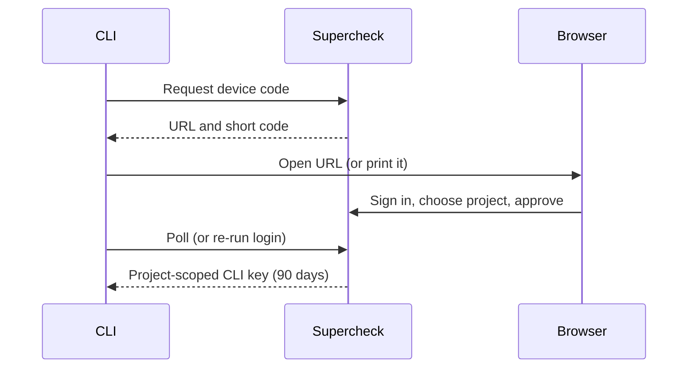

Prefixed tokens identify the type and scope of access.

## Token types

| Token | Prefix | Purpose | Scope |
|---|---|---|---|
| **CLI token (PAT)** | `sck_live_` | CLI and API access | Project-scoped, inherits the creator's RBAC permissions |
| **Trigger key** | `sck_trigger_` | CI/CD job triggers | Single job |

## Sign In

<Steps>
<Step>

### Run login

```bash
supercheck login
```

The CLI prints a URL and a short code. You approve the request in your browser and choose the project the CLI may access.

</Step>
<Step>

### Verify

```bash
supercheck whoami
```

Shows your API URL, project and role. `supercheck --json whoami` adds the organization. Token identity and expiry appear when your role can view API keys. A project viewer lacks the API key permission, so it cannot create a CLI token or sign in with the CLI. A 401 hints at `supercheck login --reauth` or a valid `SUPERCHECK_TOKEN`.

</Step>
</Steps>



The key from browser login is project-scoped, expires after 90 days and appears under **CLI Tokens**, where you can revoke it. Each project holds up to 20 active (enabled and unexpired) CLI tokens, and every browser login creates one, so revoke unused tokens. Signing in to the dashboard does not authenticate the CLI. Flags: [`supercheck login`](/docs/cli/commands#supercheck-login).

Resetting your account password revokes all your CLI tokens. Trigger keys are not affected.

## Create a token manually

| Method | Steps |
|---|---|
| **Dashboard** | **Settings → Organization → CLI Tokens → Create token**, enter a name and optional expiry, copy the token (shown only once) |
| **API** | `POST /api/cli-tokens` with `{"name": "CI/CD Pipeline"}` |

```bash
curl -X POST https://app.supercheck.io/api/cli-tokens \
  -H "Authorization: Bearer $SUPERCHECK_TOKEN" \
  -H "Content-Type: application/json" \
  -d '{"name": "CI/CD Pipeline"}'
```

Enable, disable or revoke tokens from the dashboard. `supercheck logout` clears stored credentials.

## Trigger keys

A trigger key (`sck_trigger_*`) can only trigger one job. It cannot access other API resources or authenticate other commands.

```bash
export SUPERCHECK_TRIGGER_KEY="sck_trigger_..."
curl -X POST https://app.supercheck.io/api/jobs/<id>/trigger \
  -H "Authorization: Bearer $SUPERCHECK_TRIGGER_KEY"
```

`job trigger --wait` also needs a CLI token that can read job details and run results in that project. Creating a trigger key requires `--show-secrets`, because its value is returned once.

## Environment variables

| Variable | Required | Description |
|---|---|---|
| `SUPERCHECK_TOKEN` | Usually | CLI token for most commands, `deploy`, `diff`, `whoami` and `job trigger --wait` |
| `SUPERCHECK_TRIGGER_KEY` | For `job trigger` | Job-specific trigger key (`--wait` also needs the CLI token) |

`test run --offline` and `job run --local --offline` need no credential.

| `SUPERCHECK_URL` | No | Base URL (default: `https://app.supercheck.io`). The CLI sends your token only over `https://`, or `http://` to `localhost`, `127.0.0.1` or `[::1]`. An empty value is ignored |
| `SUPERCHECK_ORG` | No | Default organization ID (UUID) |
| `SUPERCHECK_PROJECT` | No | Default project ID (UUID) |
| `HTTP_PROXY`, `HTTPS_PROXY` | No | Proxy URL for HTTP / HTTPS requests |
| `NO_PROXY` | No | Hosts to bypass the proxy (comma-separated) |
| `SUPERCHECK_REQUEST_TIMEOUT_MS` | No | Timeout for browser-login requests in milliseconds (5000 to 120000, default 30000) |

`SUPERCHECK_ORG` and `SUPERCHECK_PROJECT` override the matching `supercheck.config.ts` fields. The project-scoped token decides actual API access.

<Callout type="warn">
`SUPERCHECK_TOKEN`, `SUPERCHECK_URL`, `SUPERCHECK_TRIGGER_KEY`, every proxy setting (`HTTP_PROXY`, `HTTPS_PROXY`, `ALL_PROXY`, `NO_PROXY`, in either case) and the TLS settings `NODE_TLS_REJECT_UNAUTHORIZED`, `NODE_EXTRA_CA_CERTS`, `NODE_OPTIONS`, `NODE_USE_ENV_PROXY`, `SSL_CERT_FILE`, `SSL_CERT_DIR` and any `DOTENV_*` variable are not read from a project's `.env` file, because a hostile repository could use them to intercept your token. Export them in your shell, use your CI secret store, or run `supercheck login`. Other `.env` variables, such as `SUPERCHECK_ORG` and `SUPERCHECK_PROJECT`, still load.
</Callout>

## Security

| Practice | Why |
|---|---|
| Copy a new token immediately | It is shown only once |
| Keep tokens in your CI secret store, never in config files | The CLI rejects configs containing token patterns |
| Rotate regularly, use separate tokens per environment, set expiry on temporary ones | Limits exposure |
| Prefer trigger keys when you only need to trigger a job | Least privilege |
| Avoid `--show-secrets` in CI logs, shared terminals and agent transcripts | It reveals sensitive values |

The CLI redacts credential fields in output by default: notification provider webhook URLs, Discord and Teams webhook credentials and provider config headers. Monitor target URLs stay visible; `Authorization` and `Cookie` headers are masked.

Organization and billing administration, member management, creating projects, and deleting, restoring or cancelling deletion of an organization or project need a browser session. Project-scoped CLI tokens get `403` for these, even for organization administrators. Tokens still support scoped organization and project discovery, authentication context and authorized resource operations in their project.

<Accordions>
<Accordion title="Repository trust and .env warnings" id="repository-trust">

In human-readable mode the CLI warns when a `.env` sets a protected variable (JSON output is unchanged). Commands that load `supercheck.config.ts` still execute that file, which is code: do not run `deploy`, `pull` or `diff` in a repository you do not trust. `onboard`, `discover`, `link`, `plan`, `ci`, `agent` and `doctor` never run it (`doctor --fix` does run `npx playwright install` from the repository, so use it only where you trust the repository).

If your config reads `process.env.SUPERCHECK_URL` from `.env`, export it in your shell or CI instead, or the CLI uses the default URL.

</Accordion>
<Accordion title="Rate limits" id="rate-limits">

Trigger keys default to 100 requests per 60-second window; administrators can set a different limit per key. Other endpoints may have their own limits. On `429`, the CLI backs off exponentially, honors `Retry-After` and retries idempotent requests.

</Accordion>
<Accordion title="Self-hosted" id="self-hosted">

Set `SUPERCHECK_URL` or run `supercheck login --url https://supercheck.yourdomain.com`. Browser sign-in needs `DEVICE_AUTH_ENABLED=true` on the server (HTTPS or localhost). Without it, create a token in the dashboard and run `supercheck login --token <token>`.

</Accordion>
</Accordions>
