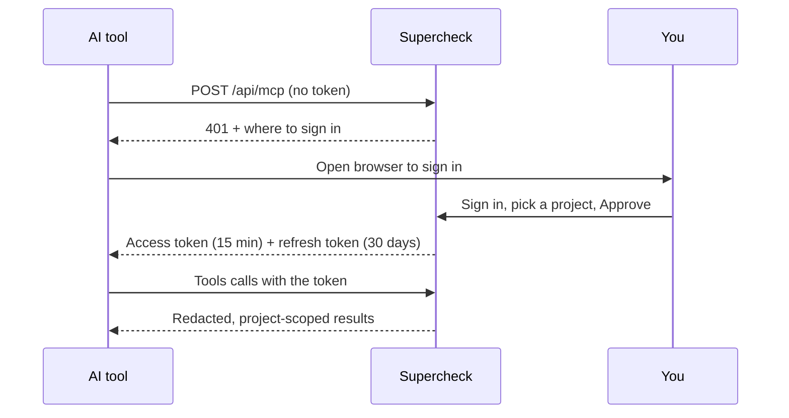

The Supercheck MCP server lets an AI tool that supports the [Model Context Protocol](https://modelcontextprotocol.io) look at one of your projects: tests, jobs, recent runs, monitors, requirements and their coverage, status pages, the service catalog, variable names, incidents and AI SRE investigation results. Ask "which runs failed overnight?", "which requirements have no passing test?" or "what did the last investigation recommend?" without copying data between tabs.

By default the server is **read-only**. Two optional scopes, approved as part of the same single request, let the tool work incidents (`mcp:incidents:write`) or start AI SRE analysis (`mcp:sre`). Creating, changing or deploying tests and monitors always goes through the [Supercheck CLI](/docs/cli).

## At a glance

| | |
|---|---|
| Endpoint | `https://<your-supercheck-host>/api/mcp` |
| Transport | Streamable HTTP |
| Sign-in | OAuth 2.1 with PKCE; you approve each connection in the browser |
| Access | One project per connection. Scope `mcp:read`, plus optional `mcp:incidents:write` and `mcp:sre` |
| Tools | Read-only unless you grant an optional scope. See [Tools](/docs/mcp/tools) |
| Availability | Off by default. Self-hosted: see [Self-Hosted](/docs/app/deployment/self-hosted#connecting-ai-tools-mcp-off-by-default) |

## How a connection works

## What the AI tool can and cannot see

- **Can see:** names, types, priorities, statuses, schedules, run outcomes, durations, a short redacted error excerpt, monitor hosts and non-secret check settings, requirement coverage and linked tests, status page components, services and their dependencies, variable names (never values), incident titles, root-cause summaries and investigation recommendations.
- **Cannot see:** test scripts, variable or secret values, notification channels, monitor credentials, headers and request bodies, status page subscribers, API keys, other projects, other organizations.
- **Cannot do (read-only connection):** write anything, trigger a run, start AI SRE work or spend AI credits. With `mcp:incidents:write` it can assign, acknowledge and resolve incidents as you; with `mcp:sre` it can start triage, investigations and evidence briefs. It never creates, edits or deletes tests, monitors, jobs or variables.

Your own role still applies. A viewer connects with viewer access; if your role loses access to a resource, the tool call is refused.

## Next steps

<Cards className="grid-cols-1 sm:grid-cols-3">
<Card title="Connect" href="/docs/mcp/connect">Add the server to your AI tool</Card>
<Card title="Tools" href="/docs/mcp/tools">Scopes and tool reference</Card>
<Card title="Security" href="/docs/mcp/security">What is filtered and limited</Card>
</Cards>
