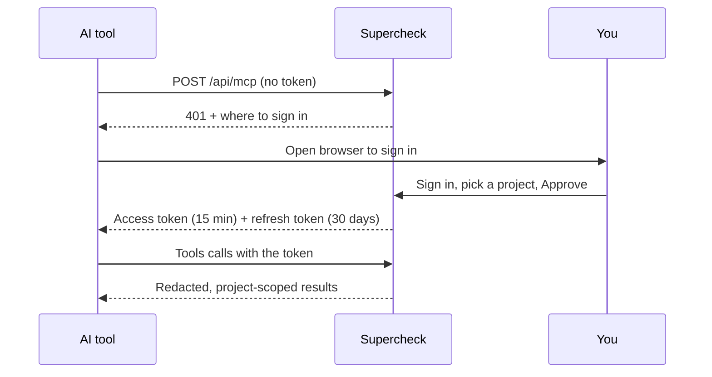

The Supercheck MCP server lets an AI tool that supports the [Model Context Protocol](https://modelcontextprotocol.io) read one project: tests, jobs, runs, monitors, requirements and coverage, status pages, services, variable names, incidents and AI SRE investigations. Ask "which runs failed overnight?" or "what did the last investigation recommend?" without copying data between tabs.

The server is **read-only** by default. Two optional scopes, approved in the same request, let the tool work incidents and maintenance windows (`mcp:incidents:write`) or start AI SRE analysis (`mcp:sre`). Creating, changing or deploying tests and monitors always goes through the [CLI](/docs/cli).

## At a glance

| | |
|---|---|
| Endpoint | `https://<your-supercheck-host>/api/mcp` |
| Transport | Streamable HTTP |
| Sign-in | OAuth 2.1 with PKCE; you approve each connection in the browser |
| Access | One project per connection. Scope `mcp:read`, plus optional `mcp:incidents:write` and `mcp:sre` |
| Availability | Off by default. Self-hosted: see [Self-hosted](/docs/app/deployment/self-hosted#connecting-ai-tools-mcp-off-by-default) |

## How a connection works

## What the AI tool can and cannot do

- **Can see:** names, types, priorities, statuses, schedules, run outcomes, durations, a short redacted error excerpt, monitor hosts and non-secret check settings, requirement coverage and linked tests, status page components, services and dependencies, variable names (never values), incident titles, root-cause summaries and investigation recommendations.
- **Cannot see:** test scripts, variable or secret values, notification channel settings (only name, type, preset and health), monitor credentials, headers and request bodies, status page subscribers, API keys, other projects or organizations.
- **Read-only connection:** cannot write, trigger a run or start AI SRE work.
- **With `mcp:incidents:write`:** declares (which notifies your team), assigns, acknowledges and resolves incidents, and schedules, ends, extends and cancels maintenance windows, as you. It never posts to a status page.
- **With `mcp:sre`:** starts triage, investigations and evidence briefs.
- It never creates, edits or deletes tests, monitors, jobs or variables.

Your role still applies. If your role loses access to a resource, the tool call is refused.

To see how AI agents find your public site, try the free [agent readiness checker](/tools/agent-readiness-checker).

## Related

<Cards className="grid-cols-1 sm:grid-cols-3">
<Card title="Connect" href="/docs/mcp/connect" description="Add the server to your AI tool" />
<Card title="Tools" href="/docs/mcp/tools" description="Scopes and tool reference" />
<Card title="Security" href="/docs/mcp/security" description="What is filtered and limited" />
</Cards>
