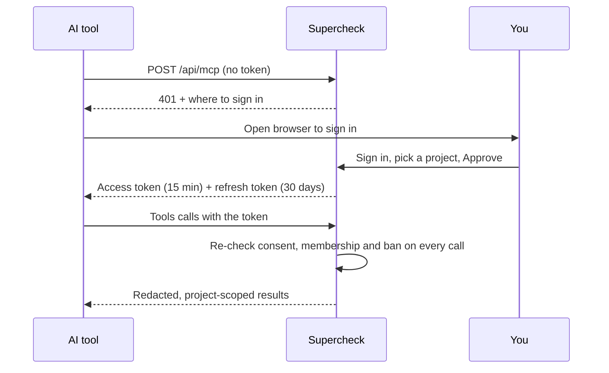

The Supercheck MCP server lets an AI tool that supports the [Model Context Protocol](https://modelcontextprotocol.io) look at one of your projects: tests, jobs, recent runs, monitors and incidents. Ask "which runs failed overnight?" or "what is the root cause of the latest incident?" without copying data between tabs.

The server is **read-only**. It cannot create, change, run or delete anything. To change things, the AI tool uses the [Supercheck CLI](/docs/cli).

## At a glance

| | |
|---|---|
| Endpoint | `https://<your-supercheck-host>/api/mcp` |
| Transport | Streamable HTTP, stateless |
| Sign-in | OAuth 2.1 with PKCE; you approve each connection in the browser |
| Access | One project per connection, scope `mcp:read` |
| Tools | 10, all read-only. See [Tools](/docs/mcp/tools) |
| Availability | Off by default. Self-hosted: set `MCP_SERVER_ENABLED=true` (see [Self-Hosted](/docs/app/deployment/self-hosted#connecting-ai-tools-mcp-off-by-default)) |

## How a connection works

## What the AI tool can and cannot see

- **Can see:** names, types, priorities, statuses, schedules, run outcomes, durations, a short redacted error excerpt, monitor hosts, incident titles and root-cause summaries.
- **Cannot see:** test scripts, variable or secret values, alert settings, monitor configuration, API keys, other projects, other organizations.
- **Cannot do:** anything that writes, triggers a run or spends quota.

Your own role still applies. A viewer connects with viewer access; if your role loses access to a resource, the tool call is refused.

## Next steps

- [Connect an AI tool](/docs/mcp/connect) in a minute
- [Tool reference](/docs/mcp/tools)
- [Security and privacy](/docs/mcp/security)
