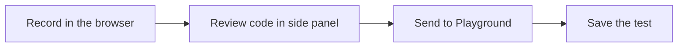

The Supercheck Recorder Chrome and Edge extension turns browser interactions into Playwright code. Review or edit the generated test, then send it to the Supercheck Playground.

## Install

| Browser | Source |
|---|---|
| Chrome | [Chrome Web Store](https://chromewebstore.google.com/detail/supercheck-recorder/gfmbcelfhhfmifdkccnbgdadibdfhioe) |
| Edge | [Microsoft Edge Add-ons](https://microsoftedge.microsoft.com/addons/detail/supercheck-recorder/ngmlkgfgmdnfpddohcbfdgihennolnem) |

The extension requires Chrome or Edge with Manifest V3 side-panel support. Store builds update automatically; GitHub releases cover air-gapped and enterprise installs (see [Install without the stores](#install-without-the-stores)).

## Connect Supercheck

### Supercheck-hosted

The extension connects without setup on these origins:

| Instance | URL |
|---|---|
| Supercheck Cloud | `https://app.supercheck.io` |
| Live demo | `https://demo.supercheck.dev` |

<Steps>
<Step>

Install the extension in the browser profile you use for Supercheck.

</Step>
<Step>

Open the instance, sign in, and visit any authenticated dashboard page.

</Step>
<Step>

The extension connects automatically. No API key or URL entry is required.

</Step>
</Steps>

This list is the extension's trust boundary and ships in the extension build. A new first-party host needs the allowlist in `recorder/examples/recorder-crx/src/supercheck/message-security.ts` updated and a new extension release. Until then, add the URL in **Options** as described under [Self-hosted Supercheck](#self-hosted-supercheck).

{/* The extension's Options page links to #self-hosted-supercheck; keep this heading. */}
### Self-hosted Supercheck

Self-hosted deployments are not trusted automatically: saving the URL once is the explicit trust decision, and the extension only talks to that exact origin.

<Steps>
<Step>

Open the extension's **Options** page.

</Step>
<Step>

Expand **Self-hosted instance**, enter the HTTPS URL of your deployment and select **Save**.

</Step>
<Step>

Sign in to that instance in the same browser profile. The extension connects automatically and stays connected on later visits.

</Step>
</Steps>

Changing the URL clears the credential saved for the previous instance. Keys are scoped to one instance and are never sent to another host.

## Record a test

<Steps>
<Step>

Open the originating Supercheck Playground and start a recording for the page you want to test.

</Step>
<Step>

Click the Supercheck Recorder icon in the toolbar, or press `Shift+Alt+R`.

</Step>
<Step>

Interact with the page. The side panel shows the generated Playwright code. Review or edit it.

</Step>
<Step>

Select **Save** in the recorder to send the code to the originating Playground editor. If the editor has unsaved changes, the Playground asks before replacing them.

</Step>
<Step>

In the Playground, select **Save** (or **Update**) to persist the test to your project.

</Step>
</Steps>

Press `Shift+Alt+C` to inspect elements without recording actions.

## Permissions and data

The extension requests debugger, tabs, storage, side-panel, scripting, and HTTP/HTTPS host access to record actions in the selected tab and hand the code to the Playground. Recorded interactions can include text entered into forms, so review generated code before saving and avoid recording real secrets. Treat the browser profile as sensitive: the extension stores its connection details there, so disconnect it before sharing the profile and revoke the key in Supercheck if the profile or device is lost.

The extension injects its page API only on the origins listed under [Connect Supercheck](#connect-supercheck) and on the instance URL saved in Options. Other pages cannot use the recorder API, read the stored credential, or start a recording.

## Install without the stores

Enterprise and air-gapped environments can install the packaged extension from GitHub releases instead of the Chrome Web Store. The release asset is the same build that is submitted to both stores.

<Steps>
<Step>

Download `supercheck-recorder-v<version>.zip` from [Recorder releases](https://github.com/supercheck-io/supercheck/releases?q=recorder-v).

</Step>
<Step>

Unzip it and open `chrome://extensions`.

</Step>
<Step>

Enable **Developer mode**, select **Load unpacked**, and choose the unzipped folder.

</Step>
<Step>

Pin the extension. Unpacked installs do not auto-update, so repeat this after each recorder release.

</Step>
</Steps>

## Troubleshooting and maintainers

<Accordions>
<Accordion title="Troubleshooting" id="troubleshooting">

| Problem | Check |
|---|---|
| The Record button shows **Install Supercheck Recorder** although the extension is installed | Confirm the page origin is one of the [hosted sites](#connect-supercheck), or save the instance URL in **Options** and reload the tab |
| Extension is not detected on a self-hosted instance | Open **Options**, save the exact HTTPS origin shown in the Record dialog, reload the tab, then sign in |
| **Too many connection checks** | The legacy verification endpoint is rate limited. Wait for the shown number of seconds, then reopen Options |
| Connection fails | Confirm the instance URL uses HTTPS, then sign in and open an authenticated dashboard page in the same browser profile |
| Extension stays **Not connected to Supercheck** after sign-in | If the extension still has its key, use **Disconnect** to revoke it, then reconnect from an authenticated page. If the extension was reinstalled or its storage was cleared, the app still holds the old key and will not issue a new one. There is no screen to revoke it yet: contact support (cloud) or your Supercheck administrator (self-hosted). If disconnect could not reach the server, keep the configuration and retry. |
| Self-hosted instance is unreachable | Open the instance directly and verify its certificate and network access |
| Recording does not start | Confirm the tab uses HTTP or HTTPS and no other debugger is attached |
| Save is unavailable | Start the recording from Supercheck so the originating Playground context is available |

</Accordion>
<Accordion title="Release process (maintainers)" id="release-process">

The recorder is released from the monorepo; app and extension versions are independent.

1. Bump `version` in `recorder/examples/recorder-crx/public/manifest.json` and `recorder/examples/recorder-crx/package.json` (the publish workflow requires them to match) and add a `CHANGELOG.md` entry.
2. Merge to `main`.
3. Create and push a signed annotated tag: `git tag -s recorder-v<version> && git push origin recorder-v<version>`.
4. The `Publish Recorder Extension` workflow builds the package, submits it to the Chrome Web Store and Edge Add-ons (gated by the `recorder-release` environment), and attaches the ZIP to a GitHub release.

Store review can take days. The GitHub release is published in the same run, so QA and self-hosted users can install the ZIP before the stores finish reviewing.

</Accordion>
</Accordions>
