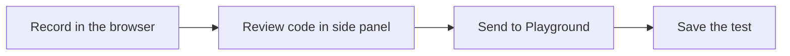

The Supercheck Recorder extension for Chrome and Edge turns browser interactions into Playwright code you send to the Playground.

## Install

| Browser | Source |
|---|---|
| Chrome | [Chrome Web Store](https://chromewebstore.google.com/detail/supercheck-recorder/gfmbcelfhhfmifdkccnbgdadibdfhioe) |
| Edge | [Microsoft Edge Add-ons](https://microsoftedge.microsoft.com/addons/detail/supercheck-recorder/ngmlkgfgmdnfpddohcbfdgihennolnem) |

It needs Chrome or Edge 114 or later (Manifest V3 side-panel support). Store builds update automatically. For air-gapped installs, see [Install without the stores](#install-without-the-stores).

## Connect Supercheck

### Supercheck-hosted

The extension connects on these origins without setup:

| Instance | URL |
|---|---|
| Supercheck Cloud | `https://app.supercheck.io` |

Install the extension in the browser profile you use for Supercheck, sign in, and open any authenticated dashboard page. The extension connects automatically, with no API key or URL entry. For any other host, see [Self-hosted Supercheck](#self-hosted-supercheck).

{/* The extension's Options page links to #self-hosted-supercheck; keep this heading. */}
### Self-hosted Supercheck

Saving the URL once is the explicit trust decision. The extension talks only to that exact origin.

<Steps>
<Step>

Open the extension's **Options** page.

</Step>
<Step>

Expand **Self-hosted instance**, enter the HTTPS URL of your deployment (plain `http://localhost` is also accepted for local development) and select **Save**.

</Step>
<Step>

Sign in to that instance in the same browser profile. The extension connects and stays connected.

</Step>
</Steps>

Changing the URL clears the credential for the previous instance. Keys are scoped to one instance and never sent to another host.

## Record a test

<Steps>
<Step>

In a browser test in the Playground, select **Start Recording** in the recording banner for the page you want to test.

</Step>
<Step>

Click the Supercheck Recorder icon, or press `Shift+Alt+R`.

</Step>
<Step>

Interact with the page. The side panel shows the generated Playwright code to review or edit.

</Step>
<Step>

Select **Save** in the recorder to send the code to the Playground editor. If the editor has unsaved changes, the Playground asks before replacing them.

</Step>
<Step>

In the Playground, select **Save** (or **Update**) to persist the test to your project.

</Step>
</Steps>

Press `Shift+Alt+C` to inspect elements without recording actions.

## Permissions and data

The extension requests debugger, tabs, storage, side-panel, scripting, and host access to all sites (`<all_urls>`, shown by the browser as reading and changing data on all websites) because a recording can start on any page. It uses them to record the selected tab and hand the code to the Playground. Recordings can capture text typed into forms, so review the code and avoid recording real secrets. The browser profile stores the connection details: disconnect before sharing the profile, and revoke the key in Supercheck if the profile or device is lost.

The page API is injected only on the [hosted origins](#connect-supercheck) and the URL saved in Options. Other pages cannot use it, read the credential, or start a recording.

## Install without the stores

For enterprise and air-gapped environments, install the packaged extension from GitHub releases. It is the same build submitted to both stores.

<Steps>
<Step>

Download `supercheck-recorder-v<version>.zip` from [Recorder releases](https://github.com/supercheck-io/supercheck/releases?q=recorder-v).

</Step>
<Step>

Unzip it and open `chrome://extensions`.

</Step>
<Step>

Enable **Developer mode**, select **Load unpacked**, and choose the unzipped folder.

</Step>
<Step>

Pin the extension. Unpacked installs do not auto-update; repeat after each recorder release.

</Step>
</Steps>

## Troubleshooting

<Accordions>
<Accordion title="Troubleshooting" id="troubleshooting">

| Problem | Check |
|---|---|
| The Record button shows **Install Supercheck Recorder** although the extension is installed | Use a [hosted origin](#connect-supercheck), or save the instance URL in **Options** and reload the tab |
| Extension is not detected on a self-hosted instance | Save the exact HTTPS origin from the Record dialog in **Options**, reload the tab, then sign in |
| **Too many connection checks** | Connection checks are rate limited. Wait the shown seconds, then reopen Options |
| Connection fails | Use HTTPS (or `http://localhost`), then sign in and open an authenticated dashboard page in the same profile |
| Extension stays **Not connected** (or "Not connected yet. Open Supercheck in this browser…") after sign-in | Use **Disconnect**, then reconnect from an authenticated page. If the extension was reinstalled or its storage cleared, the app keeps the old key and issues no new one: ask support (cloud) or your administrator (self-hosted) to revoke it |
| Self-hosted instance is unreachable | Open the instance directly and check its certificate and network access |
| Recording does not start | Use an HTTP or HTTPS tab with no other debugger attached |
| Save is unavailable | Start the recording from Supercheck so the originating Playground context is available |

</Accordion>
</Accordions>
